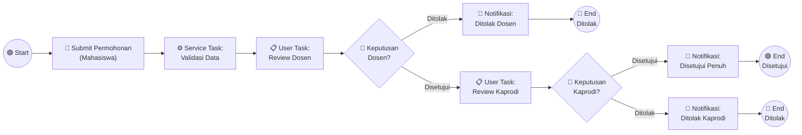

# Implementasi Business Process Model and Notation (BPMN) dengan Spring Boot Framework & Camunda Engine
### Studi Kasus: Sistem Pengajuan Cuti Mahasiswa
**Program Studi Teknik Informatika, Fakultas Sains dan Teknologi, UIN Syarif Hidayatullah Jakarta**  
**Penulis:** Narendra Yusuf Khaerudin (NIM: 12409011030064)  
**Dosen Pengampu:** Rizal Broer Bahaweres, M.Kom (`rizalbroer@uinjkt.ac.id`)  

---

## 📌 Ringkasan Eksekutif (Prinsip ABC: Accuracy, Brevity, Clarity)

Repositori ini memuat implementasi lengkap integrasi pemodelan proses bisnis **Business Process Model and Notation (BPMN 2.0)** ke dalam aplikasi berbasis **Spring Boot 3 (Jakarta/J2EE)** menggunakan **Camunda Platform 7 Embedded Engine**.

Studi kasus yang dimodelkan dan diimplementasikan adalah **Sistem Pengajuan Cuti Mahasiswa**, mencakup:
1. Pengajuan cuti oleh mahasiswa melalui antarmuka web.
2. Otomasi validasi data kelayakan oleh sistem (*Service Task*).
3. Evaluasi & persetujuan berjenjang:
   - Dosen Pembimbing (*User Task & Exclusive Gateway*).
   - Ketua Program Studi (*User Task & Exclusive Gateway*).
4. Otomasi pengiriman notifikasi hasil evaluasi kepada mahasiswa (*Service Task*).

---

## 1. Analisis 5W (What, Why, Who, Where, When) <Bobot 10%>

### 1.1. Spring / Spring Boot Framework
| 5W | Spring Framework | Spring Boot Framework |
| :--- | :--- | :--- |
| **What (Apa)** | Framework open-source enterprise Java dengan fitur utama Dependency Injection (DI), Inversion of Control (IoC), Aspect-Oriented Programming (AOP), dan Spring MVC. | Ekstensi Spring yang menyediakan *auto-configuration*, *embedded servlet container* (Tomcat), dan *starter dependencies* untuk membuat aplikasi production-grade secara instan. |
| **Why (Mengapa)** | Mengurangi kerumitan spesifikasi Java EE/EJB lama yang kaku, menyediakan pemrograman berbasis POJO yang mudah diuji (*testable*). | Menghilangkan konfigurasi XML/boilerplate yang rumit, mempercepat siklus pembuatan aplikasi (*rapid application development*). |
| **Who (Siapa)** | Diinisiasi oleh Rod Johnson (2003), dikembangkan oleh Pivotal / Broadcom, digunakan oleh jutaan developer enterprise dunia. | Diciptakan oleh tim Spring/Pivotal (Phil Webb dkk., 2014) untuk arsitektur modern microservices dan cloud. |
| **Where (Di mana)** | Digunakan pada backend enterprise, core banking, e-commerce, sistem integrasi, dan web portal. | Digunakan pada microservices, cloud-native services (Docker/Kubernetes), REST API backend, dan aplikasi BPM modern. |
| **When (Kapan)** | Versi 1.0 dirilis Maret 2004; digunakan ketika membutuhkan kontrol arsitektur modular skala besar. | Versi 1.0 dirilis April 2014 (versi 3.x saat ini); digunakan ketika memulai proyek baru dengan prinsip *convention over configuration*. |

---

### 1.2. BPM dan BPMN
| 5W | Business Process Management (BPM) | Business Process Model and Notation (BPMN) |
| :--- | :--- | :--- |
| **What (Apa)** | Disiplin ilmu manajemen dan rekayasa perangkat lunak untuk mendesain, memodelkan, mengeksekusi, memantau, dan mengoptimalkan proses bisnis organisasi (Weske, 2007). | Standar notasi grafis internasional (ISO/IEC 19510:2013) yang dikeluarkan oleh Object Management Group (OMG) untuk memvisualisasikan alur proses bisnis secara presisi. |
| **Why (Mengapa)** | Menghilangkan inefisiensi alur kerja manual, mencegah bottleneck, menyediakan audit trail otomatis, dan mempercepat adaptasi bisnis. | Menyediakan bahasa visual universal yang dipahami oleh analis bisnis, stakeholder manajerial, dan software engineer. |
| **Who (Siapa)** | Digunakan oleh Business Analyst, Process Owner, dan Enterprise Software Architect. | Dikelola oleh konsorsium OMG; digunakan oleh pemodel proses dan dieksekusi oleh mesin BPM (Camunda, jBPM, Activiti). |
| **Where (Di mana)** | Diterapkan pada sektor perbankan (kredit/KYC), pemerintahan (e-gov), universitas (skripsi/cuti), dan logistik. | Dibuat menggunakan tools modeling (Camunda Modeler, Signavio) dan dieksekusi di dalam Process Engine aplikasi. |
| **When (Kapan)** | Diadopsi sejak era Workflow Management (1990-an) hingga BPMS modern (2000-an). | BPMN 1.0 (2004), disempurnakan menjadi standar eksekusi BPMN 2.0 (2011). Digunakan saat memodelkan proses bisnis yang kompleks. |

---

### 1.3. Keterkaitan dan Manfaat BPM dalam Pemrograman J2EE/Jakarta
1. **Pemisahan Logika Proses dari Kode Program (*Separation of Concerns*):**  
   Alur navigasi bisnis tidak di-*hardcode* di dalam puluhan pernyataan `if-else` Java, melainkan didefinisikan secara deklaratif dalam model BPMN 2.0 XML.
2. **Eksekusi Langsung (*Executable BPMN*):**  
   File diagram BPMN langsung diinterpretasikan oleh Camunda Process Engine yang tertanam (*embedded*) di dalam kontainer Spring Boot.
3. **Agilitas Perubahan Proses (*Business Agility*):**  
   Jika terjadi perubahan SOP (misalnya penambahan tahapan verifikasi berkas), analis atau pengembang cukup mengubah diagram BPMN tanpa perlu merombak ulang struktur kode Java.
4. **Monitoring dan Jejak Audit Otomatis (*Built-in Audit Trail*):**  
   Setiap riwayat aktivitas, durasi pengerjaan, dan riwayat penugasan user terekam secara otomatis di database engine tanpa perlu membuat tabel riwayat manual.

---

## 2. Instalasi, Konfigurasi & Uji Hello World <Bobot 10%>

### 2.1. Prasyarat Lingkungan (Environment Prerequisites)
- **Java SE Development Kit:** JDK 17 atau lebih tinggi (teruji pada JDK 24/26).
- **Build Tool:** Apache Maven 3.8+ (teruji pada Maven 3.9.11).
- **Database:** H2 In-Memory Database (terkonfigurasi otomatis).
- **Process Engine:** Camunda Platform 7.22.0 Community Edition.

### 2.2. Uji Hello World Endpoint
Sistem dilengkapi endpoint pengujian verifikasi konfigurasi:
- **URL Endpoint:** `GET http://localhost:8080/hello`
- **Hasil Response:**  
  ```text
  Hello World - BPMN Leave Request System is running!
  ```
- **Hasil Test Otomasi:** Unit & MockMvc Test `testHelloWorldEndpoint` lulus (`BUILD SUCCESS`).

---

## 3. Studi Kasus: Sistem Pengajuan Cuti Mahasiswa <Bobot 50%>

### 3.1. Deskripsi Alur Bisnis
1. **Start Event:** Mahasiswa mengisi dan mengajukan formulir cuti pada aplikasi web.
2. **User Task (Mahasiswa):** Permohonan dicatat ke database H2 dengan status `DIAJUKAN`.
3. **Service Task (Validasi Sistem):** Kelas `ValidateRequestDelegate` memverifikasi kelengkapan NIM, nama, alasan, dan rentang tanggal cuti. Jika valid, status bergeser ke `MENUNGGU_PERSETUJUAN_DOSEN`.
4. **User Task (Dosen Pembimbing):** Dosen melakukan tinjauan (*review*) terhadap alasan cuti mahasiswa.
5. **Exclusive Gateway 1 (Keputusan Dosen):**
   - *Ditolak:* Memanggil `NotifyStudentDelegate`, status menjadi `DITOLAK_DOSEN`, alur berakhir di **End Event (Ditolak)**.
   - *Disetujui:* Alur diteruskan ke antrean Ketua Program Studi, status menjadi `MENUNGGU_PERSETUJUAN_KAPRODI`.
6. **User Task (Ketua Program Studi):** Ketua Prodi meninjau permohonan final.
7. **Exclusive Gateway 2 (Keputusan Kaprodi):**
   - *Ditolak:* Memanggil `NotifyStudentDelegate`, status menjadi `DITOLAK_KAPRODI`, alur berakhir di **End Event (Ditolak)**.
   - *Disetujui:* Memanggil `NotifyStudentDelegate`, status menjadi `DISETUJUI`, alur berakhir di **End Event (Disetujui Penuh)**.

---

### 3.2. Diagram Alur Proses BPMN 2.0


---

## 4. Struktur Proyek & Implementasi Kode

```text
bpmn-leave-request/
├── pom.xml                                      # Konfigurasi Maven (Spring Boot 3 + Camunda 7.22)
├── src/main/java/com/example/bpmn/
│   ├── BpmnLeaveRequestApplication.java         # Main Spring Boot Application
│   ├── controller/
│   │   └── LeaveRequestController.java          # Controller Web MVC, REST API & Camunda API
│   ├── delegate/
│   │   ├── ValidateRequestDelegate.java         # Service Task BPMN: Validasi data
│   │   └── NotifyStudentDelegate.java           # Service Task BPMN: Kirim notifikasi
│   ├── dto/
│   │   └── TaskDto.java                         # DTO untuk antrean tugas Camunda
│   ├── model/
│   │   └── LeaveRequest.java                    # Entitas JPA pengajuan cuti
│   └── repository/
│       └── LeaveRequestRepository.java          # Repositori Spring Data JPA
├── src/main/resources/
│   ├── application.properties                   # Konfigurasi H2, Camunda TTL & Webapp
│   ├── processes/
│   │   └── leave-request.bpmn                   # Definisi proses BPMN 2.0 Executable
│   └── templates/
│       ├── index.html                           # UI Formulir Pengajuan Cuti Mahasiswa
│       ├── tasks.html                           # UI Task Inbox Dosen & Kaprodi
│       └── requests.html                        # UI Monitoring Status Alur Kerja
└── src/test/java/com/example/bpmn/
    └── BpmnLeaveRequestApplicationTests.java    # Automated Integration & Workflow Tests
```

---

## 5. Panduan Menjalankan Aplikasi

### 5.1. Menjalankan Melalui Maven
Buka terminal pada direktori `bpmn-leave-request` lalu jalankan perintah:
```bash
mvn spring-boot:run
```

Aplikasi akan berjalan pada port default `8080`.

### 5.2. Akses Antarmuka Web
1. **Formulir Pengajuan Cuti:** `http://localhost:8080/`
2. **Inbox Tugas Persetujuan (Dosen/Kaprodi):** `http://localhost:8080/tasks`
3. **Monitoring Status Pengajuan:** `http://localhost:8080/requests`
4. **Verifikasi Hello World:** `http://localhost:8080/hello`
5. **Camunda Webapp (Cockpit, Tasklist, Admin):** `http://localhost:8080/camunda/app/`  
   *Username:* `admin` | *Password:* `admin`
6. **H2 Database Console:** `http://localhost:8080/h2-console`  
   *JDBC URL:* `jdbc:h2:mem:camunda-db` | *User:* `sa` | *Password:* *(kosong)*

---

## 6. Hasil Pengujian Otomasi (Automated Test Execution)

Pengujian integrasi otomatis dijalankan dengan Maven Surefire Plugin:
```bash
mvn test
```

### Log Hasil Eksekusi:
```text
[INFO] Running com.example.bpmn.BpmnLeaveRequestApplicationTests
2026-10-13 INFO - Menerima pengajuan cuti untuk: Narendra Yusuf Khaerudin (NIM: 12409011030064)
2026-10-13 INFO - Instance proses BPMN berhasil dibuat dengan ID: f21679ee-c6b7-11f1-a692-14d424cce0b8
2026-10-13 INFO - [BPMN SERVICE TASK] Memulai Validasi Permohonan Cuti
2026-10-13 INFO - Validasi BERHASIL untuk Mahasiswa: Narendra Yusuf Khaerudin, Status: MENUNGGU_PERSETUJUAN_DOSEN
2026-10-13 INFO - Menyelesaikan Task: 'Review Dosen Pembimbing', Keputusan: DISETUJUI
2026-10-13 INFO - Menyelesaikan Task: 'Review Ketua Program Studi', Keputusan: DISETUJUI
2026-10-13 INFO - [NOTIFIKASI MAHASISWA] Yth. Narendra Yusuf Khaerudin: Pengajuan cuti Anda telah DISETUJUI
[INFO] Tests run: 3, Failures: 0, Errors: 0, Skipped: 0
[INFO] BUILD SUCCESS
```

---

## 7. Dokumen Formal Format IEEE

Dokumen formal tugas ini disusun mengikuti gaya dan tata letak artikel konferensi **IEEE** (mengacu pada makalah referensi *Seminar Nasional Semantik 2012* oleh Bapak Rizal Broer Bahaweres).

Dokumen interaktif berbasis HTML & CSS telah tersedia pada:
- **Lokasi File:** [`dokumen-ieee/index.html`](file:///C:/Users/rendr/OneDrive/Desktop/Test/dokumen-ieee/index.html)
- **CSS Stylesheet:** [`dokumen-ieee/css/ieee-style.css`](file:///C:/Users/rendr/OneDrive/Desktop/Test/dokumen-ieee/css/ieee-style.css)

Dokumen memuat seluruh tabel analisis 5W, perbandingan pendekatan tradisional vs BPM, diagram arsitektur, diagram BPMN 2.0, serta tabel skenario pengujian.

---

## 8. Informasi Kontak & Pengumpulan Tugas <Bobot 15%>
- **Mahasiswa:** Narendra Yusuf Khaerudin (NIM: 12409011030064)
- **Program Studi:** Teknik Informatika, Fakultas Sains dan Teknologi
- **Universitas:** UIN Syarif Hidayatullah Jakarta
- **Dosen Pengampu:** Rizal Broer Bahaweres, M.Kom (`rizalbroer@uinjkt.ac.id`)
- **Tautan Repositori GitHub:** *(Dapat dipush ke GitHub pribadi mahasiswa lalu di-share ke email dosen pengampu)*
